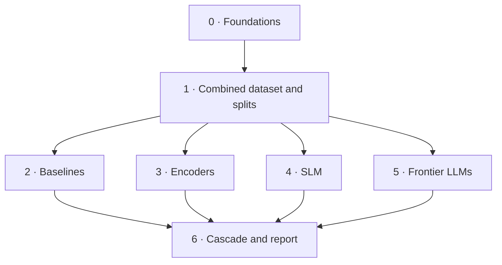

# Phishing Detection Model Comparison — Project Plan

## Goals
1. Detection performance
2. Costs in latency, memory, and API costs
3. System 1 model vs LLM
4. Cascade system good? Target: keeps ≥95% of the best single model's recall (at 1% false-positive rate) while sending ≤10% of emails to the top tier.

## Model lineup

| Family | Models | Zero-shot | Few-shot | Fine-tuned | Runs on |
| --- | --- | --- | --- | --- | --- |
| Rules | Handwritten heuristics (lookalike domains, link/text mismatch, urgency words) | Yes | — | — | Local CPU |
| Traditional ML | TF-IDF + logistic regression | — | — | Yes | Local CPU |
| Fine-tuned encoders | ModernBERT, DeBERTa-v3 | — | — | Yes | Local GPU (MPS) |
| System 1 decision model | Laya | Yes | — | If the library supports it (checked in Phase 3) | Local GPU (MPS) |
| Small language model | Qwen3.5-4B (4-bit MLX checkpoint pinned in Phase 4), prompted | Yes | Yes | — | Local (MLX, for answer-token probabilities) |
| Frontier LLMs | Claude Sonnet 5.5 ($2/$10 per 1M tokens) and Claude Haiku 5.5 ($0.10/$0.50), via Anthropic's API | Yes | Yes | — | API |
| Cascade | Four tiers, escalating only uncertain emails. Each tier's model is the best on validation among: Tier 1 rules or TF-IDF + LR → Tier 2 Laya, ModernBERT or DeBERTa-v3 → Tier 3 Qwen ~4B → Tier 4 the best frontier LLM | — | — | Tier choice and thresholds tuned on validation | Mixed |

The fine-tuned encoders are the key control for Laya: they are a similar size and speed, and ModernBERT is Laya's own backbone, so they show whether the System 1 approach adds anything beyond a well-trained classifier.

Dropped:

- SpamAssassin / rspamd and header-based features (SPF/DKIM, domain age): they need raw headers or live lookups that a combined dataset doesn't provide.
- Naive Bayes, LightGBM, character CNN on URLs, embeddings + linear head, DistilBERT, RoBERTa, SetFit, zero-shot NLI classifiers, safety classifiers (Llama Guard, ShieldGemma), LoRA-fine-tuned SLMs, other SLMs (Gemma, Llama, Phi): lower priority or cost; can be added later as extra detectors without changing the harness.
- Other frontier LLMs: OpenAI GPT-6.x and Google Gemini (no API credit for them) and flagship-priced Claude Opus 5.5 ($4/$20). Phase 5 decisions and sources are in [phase5-plan.md](phase5-plan.md).

## Dataset

The project uses one ready-made combined public phishing dataset for now, with our own cleaning and frozen splits. Results on it are labelled **preliminary** until a dataset we build ourselves exists (see [Later: building our own dataset](#later-building-our-own-dataset)).

**Chosen (Phase 1):** [Phishing Email Curated Datasets](https://zenodo.org/records/8339691) (Champa et al., Zenodo record 8339691, CC-BY-4.0), 9 of its 11 CSVs: CEAS-08, Nazario, Nigerian Fraud, SpamAssassin, TREC-05/06/07, Enron, Ling. Nazario_5 and Nigerian_5 are left out (they repeat the phishing and add legitimate mail of unstated origin). Frozen as `data/splits/champa2023-v1`:

| Split | Emails | Phishing | Legitimate |
| --- | --- | --- | --- |
| Train | 119,755 | 53,598 | 66,157 |
| Validation | 25,660 | 11,484 | 14,176 |
| Test | 25,666 | 11,487 | 14,179 |
| Validation LLM subsample | 2,500 | 1,118 | 1,382 |
| Test LLM subsample | 2,500 | 1,118 | 1,382 |

How it meets the requirements below, and where it doesn't:

- Source recorded: one file per corpus, kept as `source` on every email.
- Spam vs. phishing: **not separated.** Source label 1 means spam or phishing and is mapped to phishing (decision: matches most papers). Nazario and Nigerian Fraud are phishing/fraud by construction and are reported separately as "true phishing" recall. The test LLM subsample holds only 57 of them (20 Nazario, 37 Nigerian), so that recall has a wide confidence interval there.
- Fields: Enron and Ling have no sender, and their text is lowercased and tokenised ("may 25 , 2001"), a visible source artifact.
- Deduplication removed 5,555 exact and 31,225 near duplicates (MinHash, Jaccard ≥ 0.8 on 5-word shingles), mostly Enron emails that also appear in TREC-05; the raw TREC-05 copy is kept. 363 emails in duplicate groups with conflicting labels were dropped. 876 TREC rows with a blank label were dropped.
- Cleaning strips header lines, inline message IDs and RFC 2822 dates from bodies and caps bodies at 100k characters (77 truncated).

Rebuild: `python scripts/download_data.py` then `python scripts/build_splits.py` (needs the `data` extra). Loading a split checks its ids and content against the manifest.

Choosing the set — check each candidate (e.g. `ealvaradob/phishing-dataset` on Hugging Face, or the Kaggle sets that merge Enron, Nazario, CEAS, SpamAssassin and others) for:

| Requirement | Why | If missing |
| --- | --- | --- |
| Source corpus recorded per email (a column, or one file per source) | Lets us detect models learning the source instead of phishing | Skip the cross-source test; note it as a limitation |
| Spam kept apart from phishing | Spam labelled as phishing means we partly measure spam detection | Report binary results only and say so |
| Raw sender / subject / body available | Every model must get the same fields | Use whatever text is provided, same for all models |
| Licence allows research use | Publishing results | Choose another set |
| Size: 10k+ legitimate emails | Needed for the secondary 0.1% false-positive-rate metric on the full test set | Report the 1% headline only |

Preparing it, in order:

1. Download into `data/raw/` (git-ignored) and record the dataset version or commit.
2. Map it to one schema: `id, source (if available), label, from, subject, body, urls, split`. Labels: phishing vs. not phishing; spam/promotional kept as its own label where the set separates it.
3. Strip headers, message IDs and dates where they appear in the text, so no model can learn the source.
4. Remove exact and near-duplicates (MinHash) before splitting; phishing campaigns reuse templates.
5. Ignore any split that ships with the set; build our own (below).

Known limits of a combined set: no reliable dates (no "newer emails" test), likely included in LLM training data, and labels written by others.

## Splits and data access

Splits are built once, saved as a manifest of email IDs with a hash, and never changed; every result records that hash. No test split is ever used for tuning.

| Split | Contents | Size target | Question it answers |
| --- | --- | --- | --- |
| Train | ~70% of the combined set, stratified by label (and source, if recorded) | Most of the set | — (fitting only) |
| Validation | ~15%, same mix as train | A few thousand | — (thresholds and tuning only) |
| Validation: LLM subsample | Stratified by label, drawn from the validation split | ~2–3k, same as the test subsample (may shrink if API calls get too costly) | — (LLM thresholds, few-shot example choice, cascade hand-offs) |
| Test: same mix | ~15%, same mix, held out | As large as the set allows | Standard headline result |
| Test: cross-source | One whole source left out of training (only if source is recorded). TF-IDF + LR and one fine-tuned encoder are retrained per held-out source; zero-shot models are just scored per source | One source per run | Is it learning the source? |
| Test: LLM subsample | Stratified by label, drawn from the test split | ~2–3k | Like-for-like table across all models |

Validation size, revisited after Phase 1: the full validation split has 14,176 legitimate emails, so about 140 false positives at the 1% rate; that is enough to set thresholds for the non-LLM models. The validation LLM subsample has 1,382 legitimate emails, so only about 14 false positives at 1%; thresholds set on it for Qwen and the frontier LLMs will be noisy. Revisit before Phase 4–5 (for example, a larger validation subsample for Qwen, which runs locally at no API cost).

What each model may use:

| Model type | Train | Validation | Test |
| --- | --- | --- | --- |
| Learned (TF-IDF + LR, fine-tuned encoders, fine-tuned Laya if supported) | Fit | Threshold, early stopping, hyperparameters | Score only |
| Zero-shot (rules, Laya, Qwen, frontier LLMs) | — | Threshold; Laya's signal weights | Score only |
| Few-shot (Qwen and frontier LLMs with examples) | Example pool only; same examples for every LLM | Threshold, example choice | Score only |
| Cascade | — | Hand-off thresholds | Score only |

## Evaluation protocol

One harness scores every model on the same emails with the same code; the headline metric is recall at 1% false-positive rate on the LLM subsample, so every model is compared on the same emails. Recall at 0.1% is reported as a secondary metric for the cheaper models on the full test set; the subsample is too small to measure it (one false positive is already ~0.1%).

| Area | Metrics | Notes |
| --- | --- | --- |
| Detection | Headline: recall at 1% false-positive rate. Also PR-AUC; precision, recall, F1 at the validation-chosen threshold; recall at 0.1% false-positive rate (full test set, non-LLM models only) | Also precision re-weighted to a realistic 1% phishing rate |
| Per category | False-positive rate on spam/promotional; recall per phishing subtype | Only where the combined set has these labels |
| Calibration | Expected calibration error (ECE), reliability plot | Matters for cascade hand-offs |
| Speed | p50 / p95 latency after warmup; batched throughput | Same batch sizes; API network time reported separately |
| Resources | Peak GPU and CPU memory | GPU memory via `torch.mps.driver_allocated_memory()`, not RSS |
| Inference cost | Dollars per million emails | Tokens × list price for APIs; local models at $0 marginal, hardware noted |
| Training cost | Wall-clock training time, peak memory, hardware used, dollars for any rented GPU; number of labelled emails used | Reported next to accuracy so trained and zero-shot models are compared fairly; zero-shot models list 0 (prompt and few-shot example design noted) |
| Cascade | Share of emails escalated per tier; recall kept vs. the best single model, chosen on validation (target: ≥95%, with ≤10% of emails reaching the top tier) | Main system-level result |

Rules that keep the comparison fair:

- Every model receives the same cleaned fields and returns a score from 0 to 1:
    - Handwritten rules: a weighted count of triggered rules, scaled to 0–1 (coarse, so ties are reported as for the 0–100 LLMs).
    - Classifiers and Laya: their predicted probability.
    - SLMs: the probability of the "phishing" answer token (logprobs).
    - Frontier LLMs (Claude): a 0–100 risk score in structured output, divided by 100 (Claude returns no token probabilities). The share of tied scores is reported, since ties make recall at a fixed false-positive rate less precise.
- Each model reads up to its own context limit (DeBERTa-v3: 512 tokens; ModernBERT and Laya: about 8k; LLMs: capped at about 8k tokens, 32,000 characters, to bound API cost). The share of emails truncated per model is reported.
- Every LLM (Qwen and the frontier LLMs) gets the same task instructions from `src/phishbench/prompts.py`, written once and checked only on validation. Only the answer format differs (a single answer token scored from logprobs, or a 0–100 score).
- Unparseable outputs, timeouts and refusals count as errors, never as skipped emails. An error is always counted wrong: a miss if the email is phishing, a false positive if it is legitimate. The error rate is reported per model.
- Fine-tuned models run with 3 random seeds and the spread is reported. SLMs and frontier LLMs run once each, so their run-to-run noise is not measured. Current Claude models reject `temperature`, so Claude runs with thinking off at effort `low`; Qwen runs at temperature 0. Reruns are reproducible because every API response is cached.
- Hardware, library versions, model versions, the dataset version and training cost are written into every results file.

Statistics: because all models see the same emails, gaps are tested with paired tests (McNemar's test, paired bootstrap), and every metric carries a 95% bootstrap confidence interval.

## Roadmap

No model is compared until Phase 1 freezes the dataset; after that, the four model phases share the same splits and can run in any order or in parallel.



| Phase | Work | Gate before the next phase |
| --- | --- | --- |
| 0 · Foundations | Shared Detector interface, one harness, metrics and stub-detector unit tests. Fix Laya: error on missing answers, GPU memory measured. | Laya runs end to end on the 7 sample emails in `data/benchmark_emails.json` and writes a standard results file |
| 1 · Combined dataset and splits | Choose the combined set against the requirements above; map to the schema, strip headers, dedupe. Build and freeze the splits and the test and validation LLM subsamples, with manifest hashes. | Splits frozen and hashed; dataset version recorded |
| 2 · Baselines | Handwritten rules, TF-IDF + LR | Every model scored on the LLM subsample; non-LLM models also on the full test and cross-source splits (Phases 2–5) |
| 3 · Encoders | Fine-tuned ModernBERT and DeBERTa-v3; Laya. Fit Laya's signal weights on the validation split (replaces the hand-picked weights). Check whether the laya library supports fine-tuning; if it does, add a Laya variant fine-tuned on the training split, otherwise note it. | ″ |
| 4 · SLM | Qwen3.5-4B, prompted, corrected zero- and eight-shot comparison (MLX; completed) | ″ |
| 5 · Frontier LLMs | Claude Sonnet 5.5 and Haiku 5.5, zero- and few-shot, on the LLM subsamples. Details: [phase5-plan.md](phase5-plan.md) | ″ |
| 6 · Cascade and report | Pick each tier's model on validation (Laya may not make the cascade; it is still compared on its own), then tune hand-offs on validation; Pareto charts of accuracy, latency and cost. Write up results, limits and the recommended setup. | Report reviewed; every result reproducible from configs and manifests |

Each gate must pass before the next phase starts. Dates are not set yet.

## Repo layout and shared interface

Every model, the cascade included, implements one interface, so the harness never needs model-specific code.

```python
class Detector(Protocol):
    name: str
    def fit(self, train: Dataset, val: Dataset) -> TrainingCost: ...   # zero cost for zero-shot models
    def predict(self, emails: list[Email]) -> list[Prediction]: ...

@dataclass
class Prediction:
    score: float          # 0..1, higher = more likely phishing
    label: str | None     # optional hard label from the model
    latency_ms: float
    cost_usd: float       # 0 for local models
    error: str | None     # parse failure, timeout, refusal

@dataclass
class TrainingCost:
    wall_clock_s: float
    peak_memory_mb: float
    hardware: str         # e.g. "M4 MPS", "cloud A100"
    cost_usd: float       # rented compute only
    n_train_emails: int
```

```
llm-phishing-detection/
  pyproject.toml
  configs/models/          # one TOML per model: version, data allowed, params
  data/
    raw/                   # downloaded combined set (git-ignored)
    processed/             # cleaned JSONL in the shared schema
    splits/                # frozen manifests + hashes (committed)
  src/phishbench/
    data/                  # loader, cleaning, dedup, split builder
    detectors/             # rules, classical, encoders, laya, slm, llm, cascade
    eval/                  # harness, metrics, statistics, timing
    report/                # tables and Pareto plots
  scripts/evaluate.py      # python scripts/evaluate.py --model configs/models/laya.toml --test <emails>
  results/                 # one JSON per run
  tests/                   # unit tests with stub detectors
```

The current `src/detector.py` and `poc_system1_test.py` move into `detectors/laya.py` and the shared harness.

## Risks and open questions

| Risk | Effect | Mitigation |
| --- | --- | --- |
| Models learn the source, not phishing | Inflated scores near 100% | Strip headers, dedupe, cross-source test if the set records sources |
| The combined set is in LLM training data | LLM scores look too good | Label results preliminary; a clean test set comes with our own dataset (below) |
| Old corpora don't match today's phishing | Results don't transfer | Label results preliminary; newer-emails test comes with our own dataset (below) |
| Combined set mislabels spam as phishing | Partly measuring spam detection | Prefer a set that separates them; report the label mix |
| API cost and rate limits | Frontier runs stall or overspend | Fixed ~2–3k test and validation subsamples; Sonnet and Haiku only; one run each; cache every response; per-run cost cap; 8k-token input cap |
| API rate limits | Errors mid-run | Concurrency 8 and SDK retries; throttled calls are not cached, so a rerun resumes from the cache for free |
| 0–100 LLM scores are coarse or poorly calibrated | Recall at 1% false-positive rate is imprecise for those LLMs; cascade hand-offs misjudge uncertainty | Report tie share and calibration; if ties dominate, fall back to sampling several answers per email on the subsample |
| Model or API versions change mid-project | Results not reproducible | Pin versions in configs; log them in every results file |
| Fine-tuning large ModernBERT / DeBERTa-v3 may not fit a 16 GB M4 | Phase 3 stalls or needs smaller models | Try on the M4 first; if it doesn't fit, use base-size models or rent a cloud GPU (latency still measured on the M4) |

Notes:
- Use combined dataset for now.

## Later: building our own dataset

Deferred for now. Do this if the preliminary results look suspicious (near-perfect scores, models hard to tell apart) or before a final write-up. It replaces the combined set in Phase 1; every model then reruns unchanged on the new split manifest.

Sources (check licence and current availability before use):

| Source | Class | Era | Role | Caveat |
| --- | --- | --- | --- | --- |
| Nazario phishing corpus | Phishing | Mid-2000s to now, by year | Main phishing source; enables the time split | Older years have dated style |
| phishing_pot (GitHub) | Phishing | Recent | Newer-emails test | Honeypot mail, may skew to mass campaigns |
| CEAS 2008 | Spam / phishing | 2008 | Training pool | Mostly spam; relabel carefully |
| Nigerian fraud (419) corpus | Phishing (advance-fee) | Older | Scam subtype | Very dated style |
| Enron | Legitimate | 2000–2002 | Main benign source | No modern SaaS, MFA or invoice mail |
| SpamAssassin public corpus | Legitimate + spam | 2002–2005 | "Hard ham" for false-positive tests | Small |
| Modern benign set (collected) | Legitimate + promotional | Recent | Stops "modern = phishing" shortcut | Needs consent and anonymising |
| Synthetic set (written) | Phishing + tricky legitimate | Now | Clean test, not in any LLM's training data | Must be checked by hand |

Labels: phishing, spam/promotional, legitimate. Phishing emails also get a subtype: credential theft, CEO fraud / BEC, malicious attachment, delivery scam, advance-fee, invoice fraud.

Processing, in order:

1. Parse mbox and .eml into sender, subject and plain-text body (HTML converted to text); pull URLs and attachment filenames into their own fields.
2. Drop routing headers, message IDs and dates from the model input, so no model can learn the source.
3. Remove exact and near-duplicates (MinHash) within and across splits; phishing campaigns reuse templates.
4. Keep English only, cap length, remove personal data from the collected set.
5. Write JSONL with one schema: `id, source, year, label, subtype, from, subject, body, urls, attachments, split`.

Extra test splits this enables:

| Split | Contents | Size target | Question it answers |
| --- | --- | --- | --- |
| Test: newer emails | Recent Nazario years, phishing_pot, recent benign | A few thousand | Does it hold up over time? |
| Test: modern / synthetic | LLM-written lures, handwritten CEO fraud, tricky legitimate mail | A few hundred, hand-checked | Clean test free of training-data contamination |

Extra risks:

| Risk | Effect | Mitigation |
| --- | --- | --- |
| Synthetic emails are too easy or too uniform | Test scores look better than real-world performance | Several writers and prompts; hand-check; include tricky legitimate mail |
| Collected benign mail contains personal data | Privacy and consent problems | Consent, anonymising, never committed to the repo |
