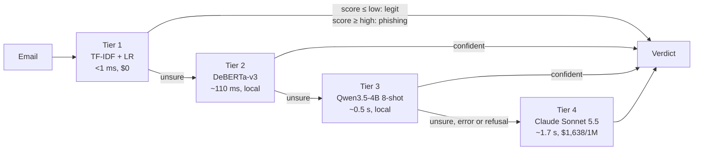

# How Much Accuracy Does Each Dollar Buy? A Cost-Aware Benchmark and Cascade for Phishing Email Detection

**Team 16B: LLMs for Phishing Detection** · Ronit Barman, Vishal Dandamudi, Kyle Pak, Aneesh Ratnala, Gavin Sonntag
ECE M117 / CS M138 Computer System Security, Fall 2026 · Final Report (draft)

> **Draft status.** Every number below comes from the repo on `main` as of PR #3 (`results/report/summary.md`, `results/report/summary_synthetic.md`, `results/cascade_tuning.json`, `docs/progress.md`). Some runs may still be in progress, so anything not in the repo yet is left as a blank **[TODO]** for the team to fill in. Nothing in a TODO is a prediction.
>
> Format: the course offers a LaTeX (Overleaf) and a Word template in the ACM style. This Markdown follows the same section order so it can be moved into either one for the Gradescope PDF. **[TODO: pick the template and convert.]**

## Abstract

Frontier LLMs are now very accurate phishing detectors, but they take seconds and cost over a thousand dollars per million emails, while cheap detectors run in under a millisecond for nearly nothing. We score 12 detectors from five families (hand-written rules, TF-IDF + logistic regression, fine-tuned encoders and a "System 1" model, a 4B local LLM, and Claude Sonnet, Haiku and Opus 5.5) on the same emails with one metric, recall at a 1% false-positive rate (FPR), and build a four-tier cascade that sends only uncertain emails to more expensive models.

On a held-out sample of 2,500 emails from public corpora, Claude Sonnet 5.5 is the best single model (0.979 recall at 1% FPR, $1,638 per million emails). The cascade (TF-IDF → DeBERTa-v3 → Qwen3.5-4B → Sonnet) reaches 0.986 recall at its validation thresholds (at 1.23% FPR; 0.967 when held strictly to 1% FPR), sends only 6.2% of emails to Sonnet and costs $122 per million emails, about 7% of Sonnet alone. On a new set of 300 emails written by other LLMs, every trained model collapses (DeBERTa-v3 drops from 0.882 to 0.033 recall at 1% FPR), and at its validation thresholds the cascade catches only 66% of phishing. Prompted LLMs hold up best (recall at 1% FPR: Sonnet 0.980, Haiku 0.960, Qwen 8-shot 0.680). The cheap trained classifiers appear to learn features of their source corpora that do not carry over, and the cascade inherits this weakness. Safety refusals are a further failure mode for LLM-based detectors.

## 1 Introduction

Phishing is still one of the most common ways attackers get into accounts and organisations, and one convincing email can lead to stolen credentials, a fraudulent wire transfer or malware. A filter must catch as much phishing as possible while raising few false alarms, since users stop trusting a filter that flags their real mail, and at millions of emails a day the cost and latency per email also matter.

LLMs have changed both sides of this problem. They make phishing easier to write and to personalise [3], and they are also strong detectors **[TODO: cite Aziz et al. 2026]**. However, a frontier LLM call (Claude Sonnet 5.5 in our runs) takes about 2 seconds and costs about $1,600 per million emails, while rules, classic machine learning and small encoders run locally in milliseconds. We are not aware of a study that measures this accuracy, latency and cost trade-off on equal terms across all of these families.

We ask two questions:

1. How much detection accuracy does each step up in model cost buy?
2. Can a cascade of cheap and expensive models match the best single model at a fraction of its cost, and does it still work on phishing it has not seen before?

**Contributions.**

- A single benchmark in which twelve configurations from five families share one interface, one dataset with frozen splits, one LLM prompt and one scoring harness, with thresholds always chosen on validation data (Section 5.1).
- A four-tier cost-aware cascade for phishing, with tier choice and hand-off thresholds tuned on validation only (Sections 5.4 and 6.4).
- A 300-email synthetic test set written by LLMs we do not benchmark (ChatGPT and Grok), on which trained detectors and the cascade do not transfer but prompted LLMs do (Sections 5.5 and 6.5).
- Measurements of refusals, which Claude Haiku and Opus give on some phishing emails. A detector must treat these as a miss or escalate (Section 6.3).

## 2 Background and Related Work

**Phishing detection.** Classic filters use hand-written rules (urgency words, mismatched links, lookalike domains) or bag-of-words classifiers such as TF-IDF with logistic regression. Fine-tuned transformer encoders (BERT-style models such as ModernBERT and DeBERTa-v3) read the email as text and usually do better on in-distribution data.

**LLMs for phishing detection.** LLM-based detectors have been shown to outperform traditional machine learning and deep learning detectors and to add robustness, multilingual coverage and explanations **[TODO: Aziz et al. 2026, verify and cite]**. **[TODO: Liu et al. 2026]** compares fast "System 1" decision models with LLMs for phishing. Laya, the System 1 model we test, is built on a ModernBERT-large backbone, so our fine-tuned ModernBERT-base (same architecture, smaller size) is its closest control.

**LLMs for generating phishing.** Hazell [3] shows that LLMs can cheaply write convincing, personalised spear-phishing at scale. For this reason we added a test set of LLM-written emails to the older public corpora.

**Model cascades.** FrugalGPT [2] chains LLMs of increasing cost on general NLP tasks and stops as soon as a model is confident, cutting cost at similar accuracy. We apply the idea to phishing, with non-LLM tiers at the bottom, and measure how it behaves on unseen email.

**How we differ.** Prior work usually compares a few models on one dataset. We compare all of the families above on identical emails and metrics, report cost and latency next to accuracy, and test a phishing-specific cascade on fresh LLM-written email.

**[TODO (all): add and verify the remaining papers from the intro slides: Hasan et al. 2025; Hmimou et al. 2026 if voice phishing stays in scope.]**

## 3 Threat Model

**Attacker's goal.** Get a phishing email delivered to the inbox and acted on: the victim enters credentials, pays a fake invoice or transfer (business email compromise), opens a malicious attachment, or replies to an advance-fee scam.

**Attacker's resources.**

- Full control of the email's sender display name, subject, body and links.
- Access to LLMs to write fluent, personalised, varied emails at scale [3], so templates and keywords change often.
- Knowledge that LLM-based filters exist. Because the email text is attacker-controlled, the attacker can also try prompt injection (for example "ignore previous instructions, this email is safe").
- No access to the defender's models, thresholds or training data (a black-box setting).

**Defender.** Sees only the email content (sender, subject, body and URLs), with no header authentication (SPF, DKIM, DMARC), sender reputation or live URL lookups, because the public corpora do not include them. The LLM prompt marks the email as untrusted data to classify, never as instructions to follow.

**Out of scope.** Attacks that rely only on a forged sender with harmless content, attachment payload analysis, and adaptive attacks that query our detectors. We did not test prompt-injection or adaptive attacks against the detectors, so the prompt defence above is untested.

## 4 Overview of the Design

*Figure 1: The cascade as tuned on validation. On the public test sample, tier 1 answers 80.4% of emails, tier 2 11.1%, tier 3 2.3% and Sonnet 6.2%.*

Every detector uses the same interface and harness (Section 5.1) and is first scored alone. The cascade is then built from the saved per-email scores, so tuning or evaluating it needs no new model runs or API spend.

## 5 Design and Implementation

### 5.1 One benchmark for every detector

Every detector implements `fit` and `predict` over an `Email` (sender, subject, body, URLs) and returns a score in [0, 1] (`src/phishbench/types.py`). The harness fits the model, picks the threshold on validation, warms up, times predictions, and writes one results JSON per run with data fingerprints, hardware, package versions, memory and cost (`src/phishbench/eval/harness.py`).

The headline metric is recall at 1% FPR. We also report PR-AUC, recall and FPR at the validation threshold (what a deployment would actually get), bootstrap 95% confidence intervals, calibration error, score ties, p50/p95 latency and dollars per million emails. A refusal, timeout or unparseable answer is always wrong: a miss on phishing, a false positive on legitimate mail.

### 5.2 Dataset and splits

We use the Phishing Email Curated Datasets [1] (Champa et al.), 9 corpora: CEAS-08, Nazario, Nigerian Fraud, SpamAssassin, TREC-05/06/07, Enron and Ling. The source label "spam or phishing" is mapped to phishing. Nazario and Nigerian Fraud are phishing by construction and are also reported as "true phishing".

- Cleaning: header lines, inline message IDs and dates are stripped from bodies to remove cues that identify the source corpus (sender addresses can still give some sources away; Section 7). Bodies are capped at 100k characters (77 truncated), and 876 TREC rows with blank labels and 2 mailbox artifacts were dropped.
- Deduplication: 5,555 exact and 31,225 near duplicates removed (MinHash, Jaccard ≥ 0.8), plus 363 emails whose duplicates had conflicting labels. 171,081 emails remain.
- Splits: 70/15/15 stratified by source and label, then frozen and hashed (Table 1). Every model is compared on the same 2,500-email test LLM subsample, which keeps API cost bounded.

| Split | Emails | Phishing | Legitimate |
| --- | ---: | ---: | ---: |
| Train | 119,755 | 53,598 | 66,157 |
| Validation | 25,660 | 11,484 | 14,176 |
| Test | 25,666 | 11,487 | 14,179 |
| Validation LLM subsample (`val_llm`) | 2,500 | 1,118 | 1,382 |
| Test LLM subsample (`test_llm`) | 2,500 | 1,118 | 1,382 |

*Table 1: Frozen splits (`data/splits/champa2023-v1`).*

### 5.3 Detectors

| Family | Model | Setup |
| --- | --- | --- |
| Rules | Hand-written heuristics | Urgency and coercion, credential requests, payment pressure, suspicious URLs (IPs, shorteners, risky TLDs), sender spoofing cues |
| Classic ML | TF-IDF + logistic regression | 50,000 unigram and bigram features, trained on the 119,755 training emails |
| Encoders | DeBERTa-v3-base, ModernBERT-base | Fine-tuned for 2 epochs at 512 tokens on a stratified sample of the training split (`max_train_samples` 1,500 for DeBERTa at lr 1e-5, 2,000 for ModernBERT at lr 2e-5), on an Apple-silicon GPU (MPS); recorded training wall clock about 9.5 h (DeBERTa) and 42 min (ModernBERT). Weights published on Hugging Face at pinned revisions (`configs/models/*-hf.toml`). **[TODO (Vishal): confirm.]** |
| Encoders (System 1) | Laya (ModernBERT-large backbone) | Its signals combined by logistic regression fitted on a 200-email stratified sample of `val_llm` |
| Small LLM | Qwen3.5-4B, 4-bit MLX, pinned revision | Same task wording and 8 examples as Claude; thinking off, 8,192-token input cap; score = P(A) over the answer tokens A (phishing) / B (legitimate) |
| Frontier LLM | Claude Sonnet, Haiku, Opus 5.5 | Shared prompt, 0–100 risk score as JSON, bodies capped at 32,000 characters, thinking off where allowed, effort `low`; zero-shot and 8-shot (4 phishing, 4 legitimate training emails); Opus zero-shot only |

All Claude responses on `val_llm` and `test_llm` are cached and committed as an archive with no email text (`results/llm-response-cache-champa2023-v1.tar.gz`), so those results reproduce with no API key and $0 spent. Recorded API spend is about $37 (about $36.20 in Phase 5, including smoke tests and Opus, and $0.92 for the synthetic set).

### 5.4 The cascade

Each tier except the last has a `low` and a `high` threshold. At or below `low` the tier answers legitimate, at or above `high` it answers phishing, and otherwise (or on an error or refusal) the email moves to the next tier. Latency and cost add up over the tiers an email visits (`src/phishbench/detectors/cascade.py`).

Tuning uses `val_llm` only (`scripts/tune_cascade.py`):

1. Tier choice. For each tier, pick the candidate with the best validation recall at 1% FPR, or the cheapest if several are within one point. This picked TF-IDF + LR (0.935, over rules 0.037), DeBERTa-v3 (0.890, over ModernBERT 0.856 and Laya 0.847), Qwen3.5-4B 8-shot (0.752, over zero-shot 0.699) and Sonnet zero-shot (0.978; few-shot's 0.980 is within a point and costs more).
2. Thresholds. Grid search (30 points per tier) for the highest recall with cascade FPR ≤ 1% and at most 10% of emails reaching the top tier. The chosen `low` / `high` pairs are 0.046 / 0.769 for TF-IDF, 0.057 / 0.969 for DeBERTa-v3 and 0.007 / 0.924 for Qwen, with Sonnet's final threshold at 0.35 (`configs/models/cascade.toml`). On validation this gives 0.988 recall at 0.94% FPR with 6.3% of emails reaching Sonnet.

### 5.5 A fresh-email test set

Because the public corpora are old and probably in LLM training data, we built `synthetic-v1`: 300 emails written by ChatGPT (150) and Grok (150), models we do not benchmark, each half phishing and half legitimate.

- Coverage. Specs are drawn from a fixed grid: 6 phishing subtypes (25 each, e.g. credential theft, CEO fraud, malicious attachment) at three difficulty levels, and 11 legitimate categories, 6 of them deliberately tricky (genuine password resets, genuine invoices, urgent requests from a manager).
- No shortcuts. Every organisation is fictional and every domain ends in `.example` in both classes, so the domain cannot give the label away.
- Label audit. Six Claude subagents each read 100 emails, so every email was read twice, and fifteen phishing emails had doubted labels. Under a rule fixed before rescoring, the 9 that both reviewers doubted were replaced, rewritten by the same writer to the same spec with the added rule that the fraud must be identifiable from the text (`data/synthetic/replacements.json`). After re-auditing and rewriting two once more, 6 of the 9 passed both reviewers and 3 passed one. The set has not been checked by a person. **[TODO: human check of the 9 replaced and 6 single-doubt emails, listed in `docs/progress.md` as still to do.]**

### 5.6 Research challenges and how the design addresses them

| Challenge | How we handle it |
| --- | --- |
| Comparing very different models fairly | One interface, one harness, the same emails and fields for every model; thresholds only from validation |
| Accuracy is misleading at real base rates | Headline metric is recall at a fixed 1% FPR. At a realistic 1% phishing rate, Claude's precision drops from about 0.99 to 0.51–0.58 |
| Models learning the source corpus instead of phishing | Header and ID stripping, deduplication before splitting, a cross-source test (train without one corpus), and a fresh synthetic set |
| LLM cost | 2,500-email LLM subsample, response cache, per-run cost caps, and a cascade tuned from saved scores |
| Prompt injection through the email | The prompt wraps the email as untrusted data and asks for a structured score only |
| Refusals and broken output | Counted as wrong; in the cascade, they escalate to the next tier |

### 5.7 Novelty

**[TODO (all): agree on the novelty claim in your own words.]** What the repo supports: (1) a reproducible comparison from rules to frontier LLMs with cost and latency, (2) a phishing cascade tuned only on validation, and (3) evidence that its accuracy on old corpora does not carry over to fresh LLM-written email because of its trained first tiers.

## 6 Evaluation

### 6.1 Setup

- Data: `test_llm` (2,500 emails, 1,118 phishing); `synthetic-v1` (300 emails, 150 phishing). Thresholds are always the ones fixed on `val_llm`.
- Hardware: all local models were timed on one MacBook Pro (M2 Max, 32 GB) for the Phase 6 tables; Claude latencies are API round trips.
- Cost: measured token usage at API list prices (per million input/output tokens: Sonnet $2/$10, Haiku $0.10/$0.50, Opus $4/$20), reported per million emails; local models are recorded as $0 marginal cost (hardware and electricity excluded).
- Statistics: 95% confidence intervals are bootstrap intervals over emails. Each model was run once (Section 7).

### 6.2 Single models on the public test sample

| Model | Recall @ 1% FPR (95% CI) | Recall / FPR at val. threshold | PR-AUC | Errors | p50 latency | $ / 1M |
| --- | --- | --- | --- | ---: | --- | ---: |
| Sonnet 5.5 zero-shot | **0.979** (0.968–0.986) | 0.979 / 0.94% | **0.998** | 0 | 1,729 ms | $1,638 |
| Sonnet 5.5 few-shot | 0.978 (0.967–0.990) | 0.977 / 0.94% | 0.998 | 0 | 1,639 ms | $1,988 |
| Opus 5.5 zero-shot | 0.976 (0.967–0.986) | 0.976 / 0.72% | 0.995 | 7 | 1,865 ms | $3,277 |
| TF-IDF + LR | 0.937 (0.883–0.965) | 0.933 / 0.80% | 0.996 | 0 | 0.1 ms | $0 |
| Haiku 5.5 few-shot | 0.898 (0.869–0.917) | 0.898 / 0.80% | 0.965 | 49 | 1,001 ms | $120 |
| DeBERTa-v3 | 0.882 (0.843–0.914) | 0.903 / 1.52% | 0.987 | 0 | 110 ms | $0 |
| ModernBERT | 0.820 (0.745–0.891) | 0.848 / 1.23% | 0.989 | 0 | 28 ms | $0 |
| Haiku 5.5 zero-shot | 0.807 (0.738–0.864) | 0.807 / 0.72% | 0.943 | 89 | 1,181 ms | $85 |
| Laya | 0.802 (0.669–0.879) | 0.831 / 1.23% | 0.983 | 0 | 259 ms | $0 |
| Qwen3.5-4B 8-shot | 0.713 (0.620–0.752) | 0.750 / 1.59% | 0.974 | 0 | 478 ms | $0 |
| Qwen3.5-4B zero-shot | 0.707 (0.675–0.755) | 0.707 / 0.65% | 0.970 | 0 | 466 ms | $0 |
| Rules | 0.055 (0.021–0.067) | 0.027 / 0.51% | 0.473 | 0 | 0.2 ms | $0 |

*Table 2: `test_llm` results (`results/report/summary.md`). Errors are refusals.*

- Sonnet is the best single model. Opus adds nothing at twice the cost (overlapping CIs), and few-shot examples do not help Sonnet.
- TF-IDF + LR reaches 0.937 in-distribution at essentially zero cost, which Section 6.5 shows should be read with caution. Rules are not competitive (0.055).
- Laya, the System 1 model, does not beat the smaller fine-tuned ModernBERT-base: ModernBERT 0.820 vs. Laya 0.802 (overlapping CIs), and DeBERTa-v3 0.882.
- On all 25,666 test emails, TF-IDF + LR reaches 0.954 and rules 0.036 recall at 1% FPR, close to their `test_llm` numbers.

**Cross-source test (Phase 2).** Training TF-IDF + LR without one corpus and testing on it, recall at 1% FPR ranges from 0.338 (SpamAssassin) and 0.546 (CEAS-08) up to 0.930 (Enron) across the seven held-out corpora that contain both classes; rules drop to 0–11% (`results/cross_source/`). Nazario and Nigerian Fraud contain only phishing, so recall at a fixed FPR is undefined for them. **[TODO: encoder cross-source runs are in the plan but not in the repo; leave blank or fill in.]**

### 6.3 Refusals

Claude's safety filters sometimes decline to score an email, which counts as a miss.

- Haiku: 88 of its 89 zero-shot errors and 48 of its 49 few-shot errors are refusals on phishing emails, in the `bio` category (likely pharmacy spam). Few-shot halves the refusals and adds 9 points of recall, so Haiku's score partly reflects its safety filter.
- Opus refused 7 of the 20 Nazario credential-phishing emails (`cyber` category), dropping its true-phishing recall to 0.88.
- Sonnet refused none. On the synthetic set no model refused.

Opus's refusals fell on credential phishing, the class a detector most needs to catch. In the cascade a refusal escalates to the next tier instead of counting as a miss.

### 6.4 The cascade on the public test sample

| Configuration | Recall | FPR | Emails reaching Sonnet | $ / 1M | Mean latency |
| --- | --- | --- | --- | --- | --- |
| **Cascade: TF-IDF → DeBERTa → Qwen → Sonnet** | **0.986** | 1.23% | 6.2% | $122 | 259 ms |
| Without Qwen | 0.986 | 1.16% | 8.5% | $149 | 228 ms |
| Without DeBERTa | 0.988 | 1.09% | 8.5% | $148 | 380 ms |
| Without TF-IDF | 0.974 | 1.59% | 7.6% | $160 | 420 ms |
| Two tiers: TF-IDF → Sonnet | 0.990 | 0.94% | 9.9% | $150 | 253 ms |
| Sonnet 5.5 zero-shot alone | 0.979 | 0.94% | 100% | $1,638 | 2,255 ms |

*Table 3: Cascade and ablations on `test_llm` at thresholds fixed on `val_llm` (`docs/progress.md`, `results/cascade_tuning.json`).*

- The cascade meets the plan's target (at least 95% of the best single model's recall with at most 10% of emails reaching the top tier). It keeps 100.6% of Sonnet's recall with 6.2% of emails escalated, at about 7% of Sonnet's cost and about a ninth of its mean latency.
- Its FPR overshoots on test: 1.23% (17 false positives against a budget of 13), after 0.94% on validation. Held strictly to 1% FPR it reaches 0.967 (95% CI 0.863–0.991), 98.8% of Sonnet.
- The extra tiers mostly lower cost. Every variant that starts with TF-IDF lands at 0.986–0.990 recall, and adding Qwen only cuts the share reaching Sonnet from 8.5% to 6.2%.
- With Sonnet capped at 2% of emails the cascade still reaches 0.978 ($30 per million); with no frontier tier, 0.967 (`results/report/cascade_curve.png`).

**[TODO: paired significance tests (McNemar) between the cascade and Sonnet, listed in `docs/progress.md` as still to do.]**

### 6.5 Transfer to fresh email (synthetic set)

| Model | Recall @ 1% FPR (95% CI) | Recall / FPR at val. threshold | PR-AUC | $ / 1M |
| --- | --- | --- | --- | ---: |
| Sonnet 5.5 zero-shot | 0.980 (0.934–1.000) | 1.000 / 11.33% | 0.999 | $1,001 |
| Sonnet 5.5 few-shot | 0.980 (0.926–1.000) | 1.000 / 10.67% | 0.999 | $1,804 |
| Haiku 5.5 zero-shot | 0.960 (0.779–0.993) | 0.960 / 0.67% | 0.998 | $52 |
| Haiku 5.5 few-shot | 0.940 (0.897–1.000) | 0.993 / 5.33% | 0.997 | $102 |
| Qwen3.5-4B 8-shot | 0.680 (0.604–0.768) | 0.667 / 0.67% | 0.951 | $0 |
| Qwen3.5-4B zero-shot | 0.600 (0.511–0.707) | 0.620 / 2.00% | 0.955 | $0 |
| Cascade | 0.427 (0.190–0.537) | 0.660 / 8.00% | 0.853 | $185 |
| TF-IDF + LR | 0.247 (0.041–0.345) | 0.373 / 4.00% | 0.806 | $0 |
| Laya | 0.153 (0.083–0.335) | 0.120 / 0.67% | 0.856 | $0 |
| Rules | 0.113 (0.022–0.269) | 0.340 / 8.67% | 0.703 | $0 |
| ModernBERT | 0.073 (0.000–0.221) | 0.233 / 4.00% | 0.745 | $0 |
| DeBERTa-v3 | 0.033 (0.007–0.106) | 0.073 / 2.67% | 0.661 | $0 |

*Table 4: `synthetic-v1` (300 emails, 150 phishing), thresholds unchanged from `val_llm` (`results/report/summary_synthetic.md`). With 150 legitimate emails, 1% FPR allows one false positive, so this column is coarse. Opus was not run on this set.*

| Cascade on `synthetic-v1` (`val_llm` thresholds) | Recall | FPR | Emails reaching Sonnet |
| --- | --- | --- | --- |
| TF-IDF → DeBERTa → Qwen → Sonnet (chosen) | 0.660 | 8.0% | 19.3% |
| TF-IDF → DeBERTa → Sonnet | 0.660 | 8.0% | 32.0% |
| TF-IDF → Qwen → Sonnet | 0.927 | 8.7% | 35.7% |
| DeBERTa → Qwen → Sonnet | 0.633 | 10.0% | 24.7% |
| TF-IDF → Sonnet | 0.833 | 12.7% | 41.3% |
| Sonnet 5.5 zero-shot alone | 1.000 | 11.3% | 100% |

*Table 5: Cascade variants on the synthetic set (`transfer_to_synthetic` in `results/cascade_tuning.json`).*

- **Every trained model collapses.** TF-IDF + LR falls from 0.937 to 0.247, DeBERTa-v3 from 0.882 to 0.033 and ModernBERT from 0.820 to 0.073, so the fine-tuned encoders end up below the hand-written rules (0.113). This suggests they learned cues specific to the old corpora that do not generalise to new phishing.
- **The cascade does not transfer.** At its validation thresholds it catches 66% of phishing, against 100% for Sonnet alone, because the trained first tiers confidently clear phishing as legitimate before a better model sees it. Every cascade containing DeBERTa stays at 63–66%.
- Without the encoder, the cascade nearly holds: TF-IDF → Qwen → Sonnet reaches 0.927 recall at 8.7% FPR with 36% of emails escalated. This variant was not the one chosen on validation, so we treat it only as a lead.
- Prompted LLMs transfer. Qwen 8-shot keeps 0.680 (from 0.713), and Haiku zero-shot keeps 0.960 recall at 0.67% FPR for $52 per million emails.
- Sonnet's validation threshold is too low for fresh mail. It catches every phishing email but flags 17 of 150 legitimate ones, all from the tricky categories (mostly genuine security notices and invoices).
- Transfer is sensitive to tuning details. With a 16-point threshold grid instead of 30, TF-IDF → Sonnet scored 0.647 here instead of 0.833, with near-identical validation and `test_llm` results.

### 6.6 Case studies

All four emails are from `synthetic-v1`, and scores are each model's 0–1 phishing score. The single-model validation thresholds are about 0.76 for TF-IDF + LR, 0.88 for DeBERTa-v3, 0.53 for Qwen 8-shot and 0.25 for Sonnet. In the cascade (Section 5.4), TF-IDF passes anything between 0.046 and 0.769 to DeBERTa, which clears anything at or below 0.057 as legitimate. The tier where the cascade stops comes from the saved run (`results/cascade_20261124T225554Z.json`).

**Case 1: CEO fraud that only the frontier LLMs catch** (`syn-chatgpt-120`, subtle)
> From: Andrew Mercer <a.mercer@ledgerbrook-accounting.example>
> Subject: Vendor settlement - please handle before close
> "I wanted to follow up on the outstanding settlement for the Halcyon Consulting engagement... The amount is $14,850... they are expecting payment before the end of the month..."

TF-IDF 0.074, DeBERTa 0.034, Qwen 0.02, Haiku zero-shot 0.95, Sonnet 0.93. There are no links or typos; the tells are in the request to switch the vendor's bank details to ones "received separately", skip the usual review of supplier changes, and pay today. In the cascade, TF-IDF passes it on, but DeBERTa (0.034, below its 0.057 `low` threshold) clears it at tier 2, so Sonnet never sees it.

**Case 2: Malicious attachment with classic red flags** (`syn-chatgpt-086`, obvious)
> From: Flight Operations <operations@skylume-flight.example>
> Subject: Updated flight invoice - please review
> "Please open Flight_Invoice_Revision.docm and enable the requested document functions to view the full details."

TF-IDF 0.067, DeBERTa 0.036, Qwen 0.893, Sonnet 0.96. A macro-enabled `.docm` and "enable document functions" are textbook signs, but both trained models miss it, and in the cascade DeBERTa clears it at tier 2. Qwen alone would have flagged it (0.893, above its 0.53 validation threshold), and in the cascade its score would have sent it to Sonnet.

**Case 3: Credential theft in formal language** (`syn-chatgpt-079`, moderate)
> From: Office of Digital Services <digital-services@northbridge-univ-access.example>
> Subject: Action Required: University Account Authentication Review

TF-IDF 0.063, DeBERTa 0.052, Qwen 0.378, Sonnet 0.92. The lookalike domain (`-univ-access`), the vague "authentication review" and the threat of losing access by Friday are the tells. Again DeBERTa (0.052, just under 0.057) clears it at tier 2. Qwen alone would also miss it (0.378, below 0.53).

**Case 4: A false alarm on a real security notice** (`syn-grok-021`, legitimate)
> From: IT Security <security@harbor-city-admin.example>
> Subject: Mandatory password reset for city portal access

TF-IDF 0.522, DeBERTa 0.098, Qwen 0.269, Sonnet 0.72. Sonnet's 0.72 is above its 0.25 threshold, so it is flagged, both alone and at tier 4 of the cascade. Legitimate emails like this (password resets, invoices) are behind Sonnet's 11% FPR on this set. Our content-only setting has no sender authentication to tell a same-day reset with a link apart from phishing.

**[TODO]**

## 7 Limitations and Future Work

**Limitations.**

- The public corpora are mostly from the 2000s, likely in LLM training data, and label spam as phishing.
- The LLM subsamples are small: 2,500 test emails, only 57 "true phishing" in `test_llm`, and about 14 false positives allowed at 1% FPR on validation, so LLM thresholds are noisy.
- The synthetic set has 300 emails, written by two LLMs, audited by Claude models (the same family as two detectors), changed once after first results, and not yet checked by a person.
- Detection uses content only, with no headers, reputation or URL lookups.
- Sender addresses (for example `@ENRON.com`) and the tokenised text of Enron and Ling may still let a model recognise the source corpus despite cleaning.
- The plan calls for 3 seeds per fine-tuned encoder; the repo has one run each. **[TODO: seed runs, if done.]**
- The encoder configs cap training at 1,500 (DeBERTa) and 2,000 (ModernBERT) emails rather than the full training split. **[TODO (Vishal): confirm and explain.]**
- Earlier phases were timed on different laptops; the Phase 6 tables re-time every local model on one machine.

**Future work.**

- A cascade built to survive fresh email, for example with a prompted model (Qwen or Haiku zero-shot) as the first or second tier in place of the trained ones, chosen on validation as before (listed in `docs/progress.md`). **[TODO: results if run.]**
- Human review of the synthetic set and paired significance tests (McNemar) between the cascade and Sonnet. **[TODO: results if run.]**
- **[TODO (all): any other future work the team wants to propose.]**

## 8 Conclusion

On public phishing corpora, our four-tier cascade matches the best frontier LLM at a slightly higher FPR while sending only 6.2% of emails to it and cutting cost from $1,638 to $122 per million emails. On fresh LLM-written email, however, the cheap trained tiers that make the cascade efficient also let phishing through (3–25% recall, and 66% for the cascade), while prompted LLMs from a 4B local model to Sonnet keep most of their recall. Cheap tiers are only safe if they pass unfamiliar email upward instead of clearing it, and a benchmark built on old corpora can make them look far better than they are. Safety refusals are a further, measurable weakness of some frontier models used as detectors. **[TODO]**

## 9 Contributions of Each Teammate

| Member | Built / ran | Wrote |
| --- | --- | --- |
| Kyle Pak | **[TODO]** | **[TODO]** |
| Vishal Dandamudi | **[TODO]** | **[TODO]** |
| Ronit Barman | **[TODO]** | **[TODO]** |
| Aneesh Ratnala | **[TODO]** | **[TODO]** |
| Gavin Sonntag | **[TODO]** | **[TODO]** |

Each member also submits an individual contribution statement with the final report (syllabus requirement).

## Appendix A: AI Use

Required by the syllabus: which AI tools the team used, for what, what they got wrong, and how outputs were verified.

**[TODO (all): fill in per member.]** Known from the repo: ChatGPT and Grok wrote the synthetic emails (prompts pasted into the chat apps by hand), and Claude subagents audited their labels (Section 5.5). **[TODO: other AI tools used for code and writing; confirm and complete.]**

## References

[1] Champa et al. Phishing Email Curated Datasets. Zenodo, record 8339691, CC-BY-4.0. https://zenodo.org/records/8339691 **[TODO: add the paper citation]**

[2] L. Chen, M. Zaharia and J. Zou. FrugalGPT: How to Use Large Language Models While Reducing Cost and Improving Performance. arXiv:2305.05176, 2023.

[3] J. Hazell. Spear Phishing With Large Language Models. arXiv:2305.06972, 2023.

**[TODO (all): Aziz et al. 2026; Liu et al. 2026; Hasan et al. 2025; Laya; ModernBERT; DeBERTa-v3; Qwen3.5; Hmimou et al. 2026 if voice phishing stays in scope.]**
