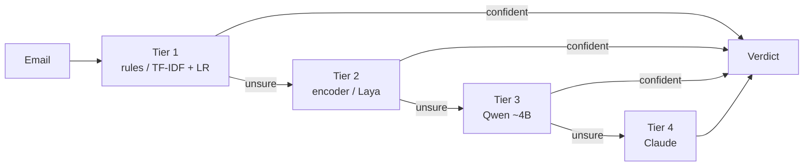

# How Much Accuracy Does Each Dollar Buy? Benchmarking Cheap-to-Frontier Phishing Detectors

**Team 16B** · Ronit Barman, Vishal Dandamudi, Kyle Pak, Aneesh Ratnala, Gavin Sonntag
ECE M117 / CS M138 Computer System Security, Fall 2026 · Mid-term Report (draft of 2026-11-16)

> Placeholders are marked **TODO (name)**. Everything else comes from the repo (`docs/PLAN.md`, `docs/progress.md`, `results/`).

## Abstract

Phishing email remains one of the most common ways attackers gain access to accounts and organisations. Large language models (LLMs) now detect phishing well, but they cost around 2 seconds and over $1,600 per million emails, while cheap detectors run in milliseconds for almost nothing but miss more attacks. We benchmark five families of detectors, ordered from cheap to expensive (hand-written rules, TF-IDF + logistic regression, encoder / "System 1" classifiers, a small local LLM, and frontier Claude models), on the same 171,081-email public dataset, with one harness and one headline metric: recall at a 1% false-positive rate. We then propose a cascade that sends only uncertain emails to more expensive tiers. So far, the frontier tier is complete: Claude Sonnet 5.5 catches 97.9% of phishing at a 1% false-positive rate, Opus 5.5 is no better at twice the cost, and model safety refusals turn out to be a measurable failure mode for phishing detection.

## I. Introduction

Phishing detectors range from free hand-written rules to frontier LLMs that cost over a thousand dollars per million emails. This project measures what each step up in cost buys and whether a cascade of cheap and expensive models can get the best of both.

The report is structured as follows. Section II states the high-level problem area. Section III describes our focused topic and potential solution. Sections IV and V outline the goals and timeline. Section VI presents preliminary results, risks and backup plans. Section VII covers related work and Section VIII concludes.

## II. High-Level Problem Area

A single convincing phishing email can lead to stolen credentials, fraudulent payments or malware. Mail filters must catch as much phishing as possible while flagging almost no legitimate mail, because users ignore a filter that raises too many false alarms. Real mail systems also process millions of emails a day, so the cost and speed of each check matter as much as its accuracy.

LLMs have been shown to outperform traditional machine-learning and deep-learning phishing detectors and to add robustness, multilingual coverage and explanations **[TODO: cite Aziz et al. 2026]**. At the same time, LLMs make phishing easier to write and to personalise for each target [3], so detectors must keep up. But LLMs are slow and expensive per email. Cheaper detectors, such as rules, classic machine learning and small encoder models, run locally in milliseconds but are less accurate. **Which detector is practical depends on the trade-off between accuracy, latency and cost**, and that trade-off has not been measured on equal terms across all of these model families.

## III. Topic and Potential Solution

### A. Topic

We ask two questions:

- How much detection accuracy does each step up in model cost buy?
- Can a combination of cheap and expensive models match the best single model at a fraction of its cost?

### B. Potential solution

Our solution has two key ideas.

1. *One benchmark for every detector.* Every model implements the same interface, sees the same emails and fields (sender, subject, body, URLs), and is scored by the same harness with the same metrics. Thresholds, prompts and hyperparameters are tuned on validation data only, never on test data. Failed predictions (unparseable output, timeouts, refusals) always count as wrong.
2. *A cascade (Figure 1).* Every email first goes to the cheapest tier. Only emails that tier is unsure about are escalated to the next tier, so most emails stop early and only the hardest reach the frontier LLM. Each tier's model and hand-off threshold are chosen on validation data. A similar cheap-to-expensive cascade idea has been used to cut LLM cost on general tasks [2]; we apply and measure it for phishing detection.

| Tier | Candidate detectors | Runs on |
| --- | --- | --- |
| 1 · Baselines | Hand-written rules; TF-IDF + logistic regression | Laptop CPU |
| 2 · Encoders / System 1 | Laya (ModernBERT-large "System 1" decision model); fine-tuned ModernBERT and DeBERTa-v3 | Laptop GPU (Apple M4) |
| 3 · Small LLM | Qwen ~4B, prompted | Laptop (MLX) |
| 4 · Frontier LLM | Claude Sonnet 5.5, Haiku 5.5, Opus 5.5 | Anthropic API |

*Figure 1: The proposed cascade. Cost and accuracy rise from left to right; the target is to send ≤10% of emails to Tier 4.*

### C. Threat model and limitations

**Threat model.** The attacker sends phishing email (credential theft, advance-fee fraud, malicious links or payment requests) and wants it delivered and acted on. The defender sees only the email's content (sender, subject, body and URLs), not header authentication (SPF/DKIM) or sender reputation. Email text is attacker-controlled, so the LLM prompt marks it as untrusted data to classify, never as instructions to follow.

**Limitations.**

- *Dataset age:* the public corpora are old (mostly 2000s), likely appear in LLM training data, and label spam as phishing, so results are preliminary.
- *Content only:* without headers or live lookups, attacks that rely only on a forged sender cannot be detected.
- *Cost:* frontier-LLM runs are capped at a 2,500-email test sample to keep API spend bounded.

## IV. Goals

The goal is to measure, for every detector family, where it sits on the accuracy–latency–cost trade-off, and to build and evaluate the cascade. We seek to answer:

- **Detection:** what recall does each detector reach at a 1% false-positive rate (FPR)?
- **Cost:** what are its latency, memory use, dollars per million emails and training cost?
- **System 1 vs. LLM:** do fast System 1 / encoder models come close to frontier LLMs?
- **Cascade:** can a cascade keep ≥95% of the best single model's recall while sending ≤10% of emails to the top tier?

## V. Timeline

The project follows the phases in `docs/PLAN.md`. Phases 2–5 depend only on phase 1 and run in parallel, and the course deliverables are the intro presentation (10/21), the mid-term presentation and report (11/16–11/18), and the final presentation (12/02) and report (12/10).

| Date | Milestone | Owner | Status |
| --- | --- | --- | --- |
| 11/14 | Phase 0: detector interface, harness, metrics, tests | Kyle | Done |
| 11/14 | Phase 1: combined dataset, cleaning, deduplication, frozen splits | Kyle | Done |
| 11/16 | Phase 5: frontier LLMs (Claude Sonnet / Haiku / Opus 5.5) | Aneesh, Gavin | Done |
| **TODO** | Phase 2: rules, TF-IDF + LR | Vishal | **TODO (Vishal)** |
| **TODO** | Phase 3: Laya, fine-tuned ModernBERT and DeBERTa-v3 | Vishal | **TODO (Vishal)** |
| **TODO** | Phase 4: Qwen ~4B, zero- and few-shot | Ronit | **TODO (Ronit)** |
| 11/18 | Mid-term presentation | All | — |
| **TODO** (before 11/30) | Phase 6: cascade, tier choice, hand-off thresholds, accuracy–cost plots | All | Planned |
| 11/30 | Final slides due; 12/02 final presentation | All | — |
| 12/10 | Final report | All | — |

## VI. Preliminary Results

### A. Dataset and splits (phases 0–1)

 **[TODO (Kyle): check and expand.]** We use the Phishing Email Curated Datasets [1], 9 corpora: CEAS-08, Nazario, Nigerian Fraud, SpamAssassin, TREC-05/06/07, Enron and Ling. The source label "spam or phishing" is mapped to phishing; Nazario and Nigerian Fraud, which are phishing or fraud by construction, are also reported separately as "true phishing".

- *Cleaning:* header lines, message IDs and dates are stripped from email bodies so no model can recognise the source corpus.
- *Deduplication:* 5,555 exact and 31,225 near duplicates were removed (MinHash, Jaccard ≥ 0.8), plus 363 emails whose duplicates had conflicting labels. 171,081 emails remain.
- *Splits:* 70/15/15, stratified by source and label, then frozen and hashed (Table 1).

| Split | Emails | Phishing | Legitimate |
| --- | ---: | ---: | ---: |
| Train | 119,755 | 53,598 | 66,157 |
| Validation | 25,660 | 11,484 | 14,176 |
| Test | 25,666 | 11,487 | 14,179 |
| Validation LLM subsample | 2,500 | 1,118 | 1,382 |
| Test LLM subsample | 2,500 | 1,118 | 1,382 |

*Table 1: Frozen splits. Every model is scored on the same 2,500-email test LLM subsample, so all models are compared on identical emails.*

### B. Results across models

Table 2 is the cross-model comparison; rows for phases 2–4 are filled in as those phases finish.

| Phase | Model | Recall @ 1% FPR | Latency (p50) | $ / 1M emails |
| --- | --- | --- | --- | --- |
| 2 | Rules | **TODO (Vishal)** | | |
| 2 | TF-IDF + LR | **TODO (Vishal)** | | |
| 3 | Laya (System 1) | **TODO (Vishal)** | | |
| 3 | ModernBERT / DeBERTa-v3 | **TODO (Vishal)** | | |
| 4 | Qwen ~4B | **TODO (Ronit)** | | |
| 5 | Claude Sonnet 5.5 (zero-shot) | **0.979** | 1.7 s | $1,638 |
| 5 | Claude Opus 5.5 (zero-shot) | 0.976 | 1.9 s | $3,277 |
| 5 | Claude Haiku 5.5 (few-shot) | 0.898 | 1.0 s | $120 |

*Table 2: All models on the test LLM subsample (2,500 emails, 1,118 phishing).*

> **TODO (Vishal):** phase 2 and 3 setup, results and observations.
>
> **TODO (Ronit):** phase 4 setup, zero- vs. few-shot results and observations.

### C. Frontier LLMs (phase 5)

- *Models and prompt:* Claude Sonnet 5.5, Haiku 5.5 and Opus 5.5, called through Anthropic's API with one shared prompt (also to be used for Qwen). The prompt marks the email as untrusted data.
- *Score:* the model returns a 0–100 risk score in structured output, which we divide by 100.
- *Settings:* thinking is off where the model allows it (Opus cannot turn it off), at effort `low`. Few-shot runs add 8 fixed training emails (4 phishing, 4 legitimate) to the prompt.
- *Inputs:* capped at 32,000 characters (~8k tokens); 0.28% of emails hit the cap.
- *Reproducibility:* every API response is cached, so all results reproduce at $0. Total spend was about $36.

| Config | Recall @ 1% FPR (95% CI) | PR-AUC | Errors | p50 / p95 latency | $ / 1M emails |
| --- | --- | --- | --- | --- | --- |
| Sonnet 5.5 zero-shot | **0.979** (0.968–0.986) | 0.998 | 0 | 1.7 / 3.6 s | $1,638 |
| Sonnet 5.5 few-shot | 0.978 (0.967–0.990) | 0.998 | 0 | 1.6 / 2.1 s | $1,988 |
| Opus 5.5 zero-shot | 0.976 (0.967–0.986) | 0.995 | 7 refusals | 1.9 / 2.7 s | $3,277 |
| Haiku 5.5 few-shot | 0.898 (0.869–0.917) | 0.965 | 49 refusals | 1.0 / 1.7 s | $120 |
| Haiku 5.5 zero-shot | 0.807 (0.738–0.864) | 0.943 | 89 refusals | 1.2 / 1.9 s | $85 |

*Table 3: Phase 5 results. Thresholds were chosen on the validation LLM subsample; refusals count as misses.*

Observations:

- **Sonnet 5.5 is the strongest model so far** and the current Tier 4 candidate. It caught all 57 "true phishing" emails.
- **Opus 5.5 adds nothing over Sonnet** (overlapping confidence intervals) at twice the cost, and **few-shot examples do not help Sonnet**.
- **Safety refusals are a failure mode.** Claude's safety classifiers sometimes decline to answer, and a refusal counts as a miss.
  - Haiku refused 88 phishing emails zero-shot and 48 few-shot, mostly in the `bio` category (likely pharmacy spam). Its lower recall therefore partly measures its safety filter rather than its judgement.
  - Opus refused 7 of the 20 Nazario credential-phishing emails (`cyber` category), lowering its true-phishing recall to 0.88.
  - Sonnet refused none.
- **Base rate matters.** Precision is about 0.99 on the test sample, where 45% of emails are phishing. Re-weighted to a realistic 1% phishing rate, precision drops to 0.51–0.58: about every other flag would be a false alarm. This is why we report recall at a fixed low false-positive rate rather than accuracy.
- **Scores are coarse.** Claude's 0–100 scores cluster on a few values (e.g. 5 and 95), so recall at a fixed FPR moves in steps. Calibration error is low (ECE 0.03–0.04).

### D. Potential risks

- *Data contamination and age:* the public corpora are old and probably in LLM training data, which may inflate LLM scores and limit transfer to modern phishing.
- *Source shortcuts:* models may learn which corpus an email came from (e.g. Enron addresses, tokenised Ling text) rather than whether it is phishing. Header stripping and deduplication reduce this; a cross-source test (train without one corpus) will measure it.
- *Spam labelled as phishing:* the dataset partly measures spam detection.
- *Small LLM validation sample:* it gives only ~14 false positives at a 1% FPR, so LLM thresholds are noisy.
- **TODO (Vishal / Ronit):** risks from phases 2–4 (e.g. fine-tuning large encoders on a 16 GB laptop).

### E. Backup plan

- If results look too good to trust (near-perfect, models hard to tell apart), we replace the test set with newer phishing (recent Nazario years, honeypot mail) plus a small hand-checked synthetic set that no LLM has seen; every model reruns unchanged on the new splits.
- If fine-tuning does not fit on our laptops, we fall back to base-size encoders or rent a cloud GPU.
- Refusals can be escalated to the next cascade tier instead of counted as misses; this rule is fixed on validation before it touches test data.

## VII. Related Work

**[TODO (all): expand with the papers from the intro slides, verified.]**

- *LLMs for phishing detection:* LLM-based detectors outperform traditional ML and deep learning and add robustness, multilingual coverage and explanations **[TODO: Aziz et al. 2026]**.
- *System 1 models vs. LLMs:* **[TODO: Liu et al. 2026]** compares fast decision models with LLMs for phishing.
- *LLMs for generating phishing:* Hazell [3] shows that LLMs can cheaply write convincing, personalised spear-phishing at scale, which raises the bar for detectors.
- *Cascades:* FrugalGPT [2] cascades LLMs of increasing cost on general NLP tasks and reports large cost savings at similar accuracy.
- *Our contribution:* we differ from these works by (1) comparing rules, classic ML, encoders, a small LLM and frontier LLMs on identical emails and metrics, and (2) measuring a cascade specifically for phishing, including safety refusals as a failure mode.

## VIII. Conclusion

We have defined the problem (the accuracy–latency–cost trade-off in phishing detection), built a shared benchmark with a frozen 171,081-email dataset, and completed the frontier-LLM tier. Claude Sonnet 5.5 sets the bar at 97.9% recall at a 1% false-positive rate for about $1,600 per million emails. Opus adds nothing at twice the cost, and safety refusals are a measurable weakness of Haiku and Opus. **[TODO (Vishal, Ronit): one sentence each on phases 2–4.]** Next, we finish the cheaper tiers and build the cascade to test whether it keeps ≥95% of Sonnet's recall while sending ≤10% of emails to it.

## References

[1] Champa et al. Phishing Email Curated Datasets. Zenodo, record 8339691, CC-BY-4.0. https://zenodo.org/records/8339691 **[TODO: add the paper citation]**

[2] L. Chen, M. Zaharia and J. Zou. FrugalGPT: How to Use Large Language Models While Reducing Cost and Improving Performance. arXiv:2305.05176, 2023.

[3] J. Hazell. Spear Phishing With Large Language Models. arXiv:2305.06972, 2023.

**[TODO (all): Aziz et al. 2026; Hasan et al. 2025; Liu et al. 2026; Hmimou et al. 2026 if voice phishing stays in scope.]**
